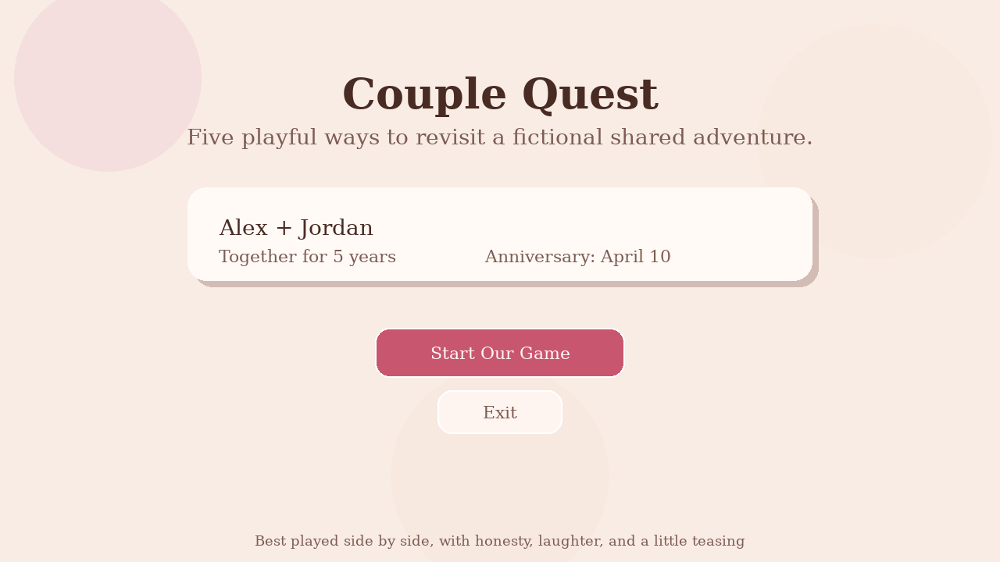
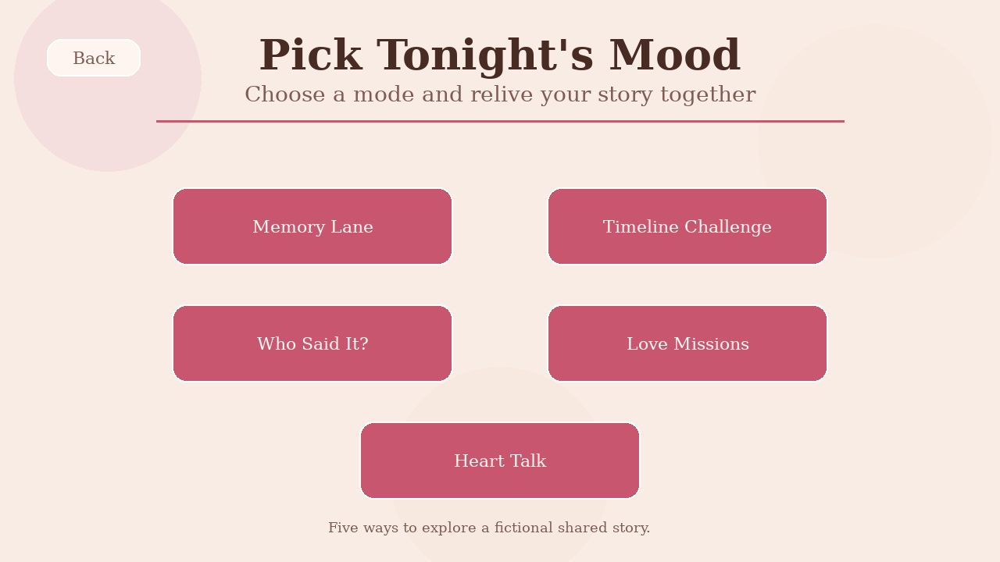
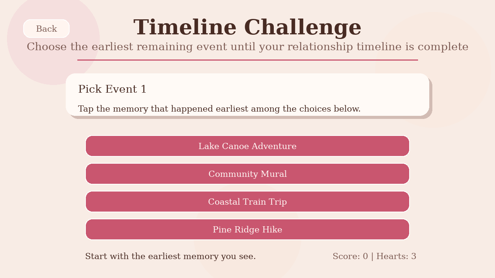

# Couple Quest — Python/Pygame Interactive Game

**An interactive desktop mini-game built with Python and Pygame CE.** Explore a fictional couple's shared adventures through five modes combining memory quizzes, chronological reasoning, quotes, playful activities, and conversation cards.

> **Public-safe portfolio edition:** Alex and Jordan are fictional characters. Every memory, question, and challenge in this repository is invented for demonstration. No original personal relationship details are included.



<details>
<summary>More sample screens</summary>





</details>

## What the player can do

| Mode | Interaction | Logic |
| --- | --- | --- |
| **Memory Lane** | Answer multiple-choice questions about shared events | Validated answers, score and three-heart limit |
| **Timeline Challenge** | Pick events from earliest to latest | True ISO-date ordering, removing solved choices |
| **Who Said It?** | Attribute fictional quotes to Alex or Jordan | Quote matching and scoring |
| **Love Missions** | Draw a small offline challenge | Random mission selection and completion summary |
| **Heart Talk** | Browse reflective conversation prompts | Deck selection and session progress |

## Quick start

Requirements: **Python 3.10+**, a graphical desktop environment, and a working audio device *if sound is desired*. The Python dependency is declared in `requirements.txt`.

### Windows PowerShell

```powershell
py -m venv .venv
.\.venv\Scripts\Activate.ps1
python -m pip install -r requirements.txt
python src/main.py
```

If activation is blocked by a PowerShell policy, use the virtual environment's Python directly:

```powershell
.\.venv\Scripts\python.exe -m pip install -r requirements.txt
.\.venv\Scripts\python.exe src/main.py
```

### macOS / Linux

```bash
python3 -m venv .venv
source .venv/bin/activate
python -m pip install -r requirements.txt
python src/main.py
```

On Windows, `play_now.bat` is also provided for environments where `python` and `pygame-ce` are already available on the path.

The app opens in a **1280 × 720 window** by default. Use the mouse to navigate, and press **Esc** to close. Set `FULLSCREEN = True` in `src/config.py` to use a letterboxed fullscreen display.

## Test the core logic

Tests use Python's standard-library `unittest` and do **not** require a display or Pygame installation:

```bash
python -m unittest discover -s tests -v
```

Coverage focuses on chronological order, date validation, removing completed timeline choices, scoring, mode selection, resets, and referential integrity of the fictional dataset.

With Pygame installed, you can also regenerate the three screenshots and check that every screen draws a frame without a physical display:

```bash
python scripts/render_previews.py
```

This headless render check is **not** a substitute for manual mouse/audio testing on a desktop.

## Project structure

```text
couple-quest-public/
├── assets/sounds/     # Synthesized WAV effects and ambience
├── data/              # Fictional JSON profile, memories, questions, missions
├── docs/              # Architecture, customization and case-study notes
├── src/
│   ├── main.py        # Event loop, scene routing and display scaling
│   ├── config.py      # Application settings and visual theme constants
│   ├── game/          # Dataclasses, data loading, validation, scoring, timeline, audio
│   ├── scenes/        # One scene per screen or game mode
│   └── ui/            # Reusable buttons, cards and drawing helpers
├── tests/             # Standard-library unit tests
├── scripts/           # Optional headless rendering check
└── requirements.txt
```

The UI is decoupled from testable game rules: timeline sorting, answer grading, content validation, and session state operate without Pygame. The main loop translates physical mouse coordinates into a fixed logical canvas and delegates interaction to the active scene.

## Fictional content and safety

- All bundled names, locations, dates and quotes are **made-up examples**.
- The JSON files illustrate the content schema; `data/memories.json` deliberately stores entries **out of chronological order** to demonstrate that game logic does not trust file order.
- If you personalize a local copy, **do not upload personal stories, dates, photographs or names to a public repository**. Git history retains earlier versions even if a file is later changed or deleted.
- The public edition does not include accounts, analytics, networking, or secrets. Its sound files are generated by the project's own audio synthesizer (`src/game/audio.py`).

See [Content Guide](docs/CONTENT_GUIDE.md) for the data format and [Architecture](docs/ARCHITECTURE.md) for design details.

## Engineering notes

This is a local desktop game and portfolio case study, **not** a hosted online service. All quizzes run locally; talk prompts do not record responses, missions do not verify physical completion, and game progress is currently session-only. A graphical runtime smoke test requires Pygame CE to be installed and a suitable display backend.

### What I would build next

1. A user-friendly content editor with a clear **private/export-safe** workflow.
2. Optional local save/load for high scores and completed missions.
3. Keyboard/controller navigation and accessibility improvements.
4. Additional tests for Pygame scenes and layout at different screen sizes.

**Tech:** Python · Pygame CE · dataclasses · JSON · `unittest` · procedural WAV synthesis.
